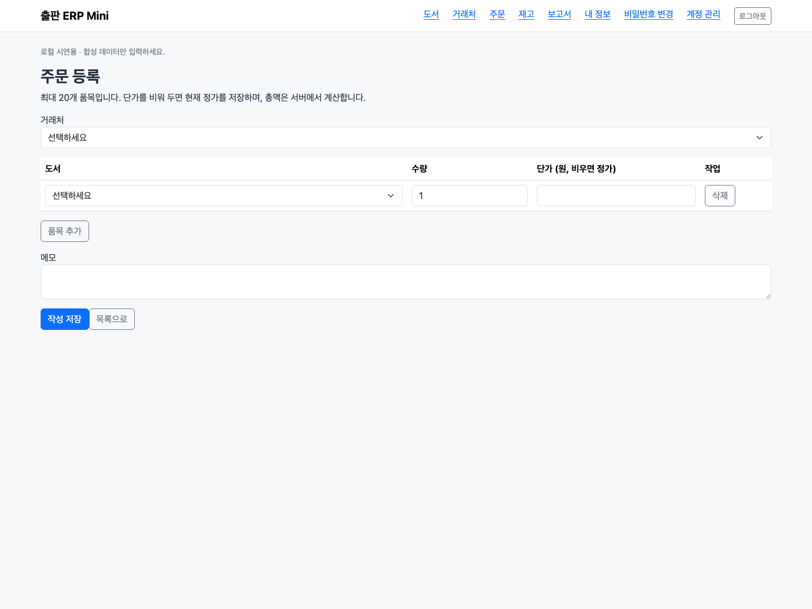
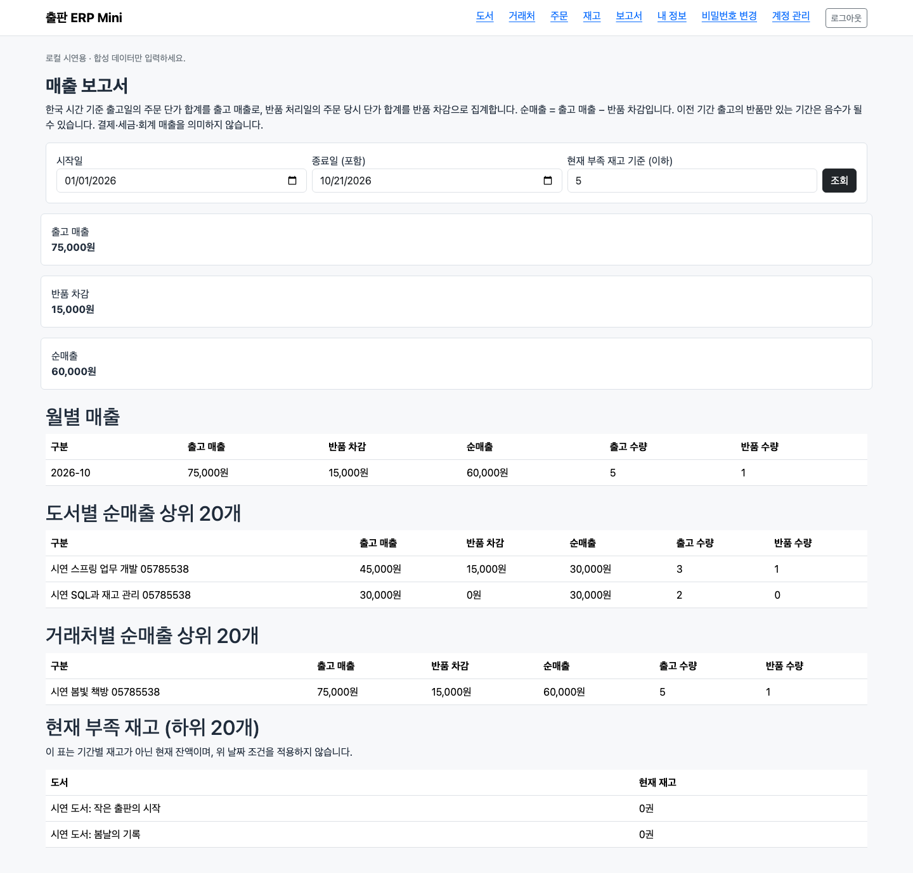

# 출판 ERP Mini

Java 21 · Spring Boot 4.1.1 · MyBatis XML · JSP/JSTL · jQuery · MariaDB로 만든 한국어 출판 업무 ERP 학습·포트폴리오입니다. 도서·거래처, 다품목 주문·출고·부분 반품, 재고 원장·매출 보고서와 세션 기반 인증을 구현했습니다. 합성 데이터만 사용합니다.

## 설계하고 검증한 과정

화면 CRUD에서 시작해 출고·반품의 데이터 정합성, 동시 요청, 과거 단가 보존과 보안 검증까지 단계적으로 다뤘습니다. 구현 이유와 실패 원인, 검사 범위와 남은 한계를 문서로 남겨 결과를 설명하고 수정할 수 있도록 학습하고 있습니다.

| 해결하려고 한 문제 | 선택과 검증 | 근거 |
| --- | --- | --- |
| 여러 품목 중 하나만 실패해 재고가 일부 저장되는 문제 | 같은 트랜잭션 참여, 합성 환경에서 일부 커밋 오류를 재현한 뒤 같은 회귀 테스트로 실패→성공 확인 | [유지보수 실험](doc/maintenance-case.md) |
| 동시·중복 출고와 반품 초과 | 행 잠금·처리 키·상태/잔여 수량 검사, 실제 MariaDB 동시성 테스트 | [업무 설계](doc/architecture.md) |
| 검사 단계 성공만으로 보안을 판단하는 문제 | Java 분석 대상 0개를 발견해 필수 패키지 범위 검사 추가, 의존성·JDK 인증서를 별도 점검 | [보안 점검](doc/SECURITY_AUDIT_2026-10-31.md) |
| 프레임워크/JDK 패치 시 기존 동작 보존 | Boot 4 호환 전환·Java 21 패치 후 WAR/JSP·전체 회귀 확인 | [Java 패치](doc/JAVA_PATCH.md) |

자세한 고민과 검증 근거는 [개발 과정](doc/DEVELOPMENT_NOTES.md), 기능·키·화면 변경 범위는 [ERP 구조 안내](doc/PROJECT_WALKTHROUGH.md)를 참고하세요. AI 개발 보조를 활용했으며, 실제 고객 장애 해결이나 실서비스 운영 실적으로 표현하지 않습니다.

## 확장 설계 — 아직 미구현

별도 쇼핑몰이 ERP의 **books.id**를 도서 식별자로 전달하고, ERP가 표준 주문 양식을 받아 작성 상태로 저장하는 [B2C 주문 수신 설계](doc/MALL_ORDER_DESIGN.md)를 정리했습니다. 별도 book_code 추가는 필수가 아니며 같은 ERP의 키를 변경·재사용하지 않는 전제입니다. 공급처별 입고·주문 배송지/수동 배송·API 인증/중복 수신 처리는 후속 구현 대상입니다.

## Mac ARM64 / RAM 8GB 빠른 시작

Java는 [프로젝트 전용 Temurin 21.0.13+9 패치 안내](doc/JAVA_PATCH.md)에 따라 준비하고 `./scripts/java-info.sh`로 확인합니다. 설치된 전용 JDK를 실행 스크립트가 우선 선택합니다. 기존 JAVA_HOME을 지정한 경우에는 해당 값을 사용하므로 전체 빌드 번호를 확인하세요.

```sh
brew install openjdk@21 mariadb@11.4
./scripts/db-start.sh
./scripts/auth-init.sh
./scripts/verify.sh
./scripts/run.sh -Dspring-boot.run.profiles=demo
```

[로그인](http://127.0.0.1:8080/login) 정보는 Git 제외·권한 600인 `.local/auth.env`를 로컬 편집기에서 확인하세요. 공유 기본 비밀번호는 없습니다. 비밀번호를 변경한 뒤에는 변경한 값을 사용합니다. `demo`는 가상 도서·거래처 각 3개를 추가하며, 주문 시연은 [대본](doc/DEMO.md)을 따릅니다.

현재 로컬 자동 테스트 **93개 통과**, Temurin 21.0.13+9에서 실행 WAR 빌드 성공. 기존 Boot 4 코드는 GitHub에서 새로 복제해 빈 테스트 DB에서도 92개를 통과했고, 이후 SQL Injection 회귀 1개를 로컬에 추가했습니다. 실제 Chromium에서 2품목 입고→주문→출고→부분 반품→보고서를 확인했습니다. 네이티브 앱은 127.0.0.1에만 바인딩합니다.

## 단계별 상태

| 단계 | 상태 |
| --- | --- |
| Phase 0·1 | 실행 기반, 도서·거래처 관리 완료 |
| Phase 2 | 주문·재고·출고·취소·부분 반품, 원자성·중복·동시성 검증 완료 |
| Phase 3 | 매출 지표·보고서, 인증·세션·권한·CSRF 검증 완료 |
| Phase 4 | 문서·실제 화면·시연·유지보수 사례·Docker 구성 준비 완료. 원격 fresh clone 검증 완료. **Compose 기동 gate 미완료** |

Docker 실행·배포·서버 호스팅은 진행하지 않았습니다. **현재 저장소는 비공개이며 공개 전환은 나중에 별도 결정합니다.** 향후 공개를 고려해 비밀 파일·로그·로컬 JDK/DB를 Git에서 제외하고 예시는 합성 데이터만 사용합니다. GitHub 업로드·원격 CI·배포의 최신 상태는 [릴리스 기록](doc/RELEASE.md)을 참고하세요.

## 주요 문서

- [GitHub·CI·배포 최신 기록](doc/RELEASE.md) · [무료 우선 호스팅 후보](doc/HOSTING_PLAN.md)

- [Boot 4 전환·파일 역할·PHP 비교·학습](doc/BOOT4_MIGRATION.md)
- [설치·실행·종료·문제 해결·백업 절차](doc/README.md)
- [실제 검증 결과·변경 파일 목록](doc/TEST_RESULTS.md) · [기능별 학습·PHP 비교](doc/PHASE2_4.md)
- [아키텍처·경로·매출 지표](doc/architecture.md) · [ERD](doc/erd.md)
- [로그인·세션·권한](doc/SECURITY.md) · [사용자 메시지 규칙](doc/USER_MESSAGES.md)
- [실패 테스트→수정→성공 유지보수 사례](doc/maintenance-case.md)
- [Docker 준비와 남은 검증](doc/CONTAINERS.md)
- [프로젝트](doc/PROJECT.md) · [설계 결정](doc/DECISIONS.md) · [할 일](doc/TODO.md) · [변경 기록](doc/CHANGELOG.md)

## 배포 전 확인

사용자 요청으로 Boot 4.1.1과 호환 MyBatis/Security, Tomcat 11·Jackson 3으로 전환했습니다. 로컬 92개 테스트와 실제 JSP/WAR 검증을 통과했습니다. 최종 원격 92개 테스트·Java 71개 패키지 분석·HIGH/CRITICAL 취약점 검사·비밀정보 검사까지 통과했습니다. 인터넷 공개 배포는 아직 하지 않았습니다. [보안 검토](doc/SECURITY_REVIEW.md)와 [릴리스 기록](doc/RELEASE.md)을 확인하세요.

## 실제 화면

주문 등록에서 단가·수량을 입력하고, 보고서에서 출고 매출과 반품 차감을 구분합니다. Boot 4에서 실제 캡처한 화면입니다. 전체 출고·반품 시연은 DEMO.md를 참고하세요.



