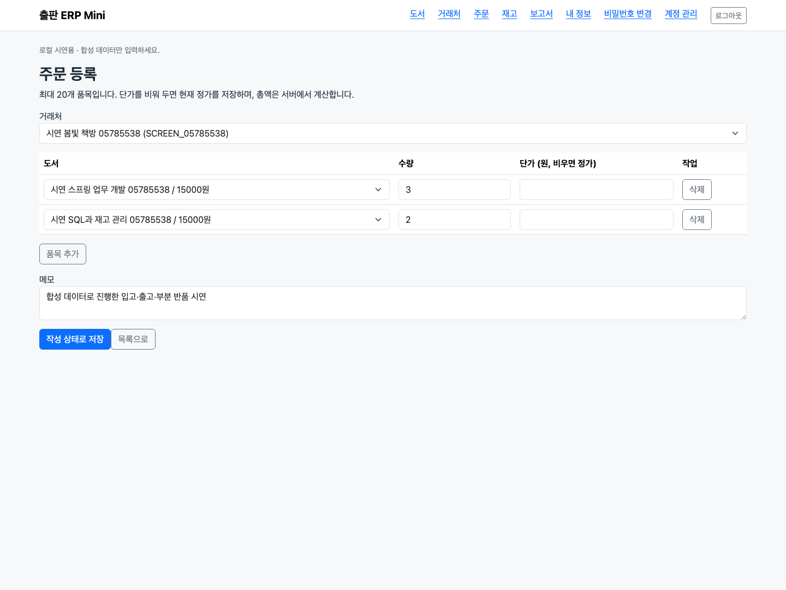
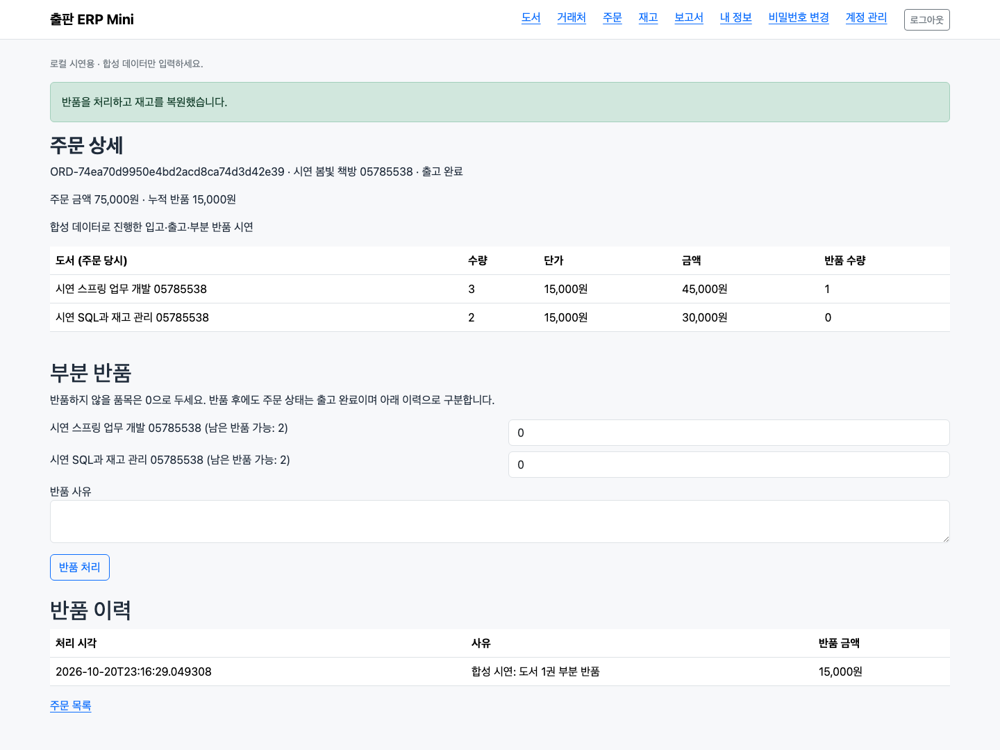
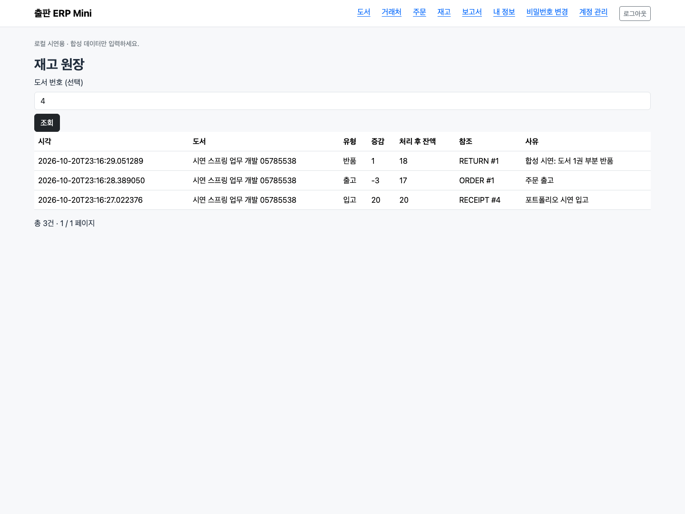
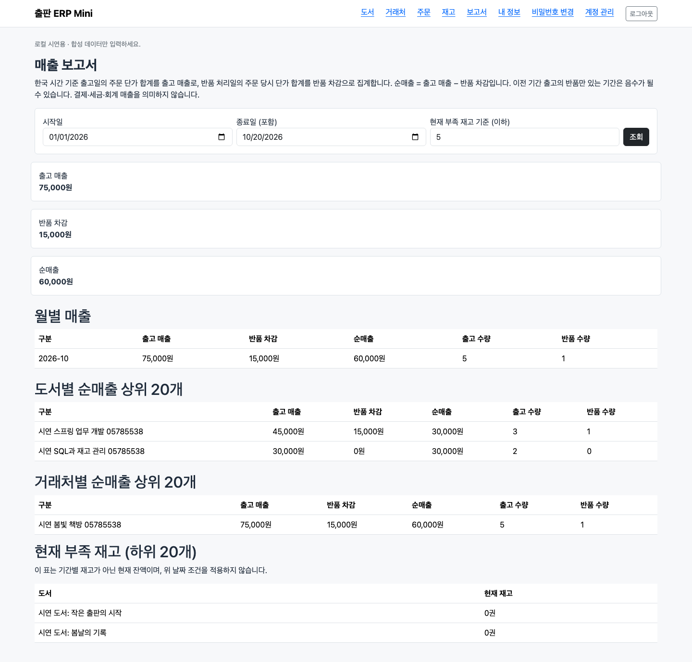

# 2~3분 시연 대본

합성 데이터만 사용한다. 앱을 demo 프로필로 실행하고 초기 로그인은 `.local/auth.env`를 로컬에서 확인한다. 공개용 공유 계정·기본 비밀번호는 없다. 시연 전에 관리자 로그인을 마친다.

| 시간 | 동작 | 설명할 내용 |
| --- | --- | --- |
| 0:00~0:25 | 도서 등록: 시연 도서 A, 정가 15,000원 | Controller 입력 검증 → Service → MyBatis. 도서와 재고 0행을 함께 생성한다. |
| 0:25~0:45 | 거래처 등록: 시연 봄빛 책방, BOOKSTORE | 업무 코드는 고유하다. 고객 실데이터를 입력하지 않는다. |
| 0:45~1:05 | 재고 → 입고, 도서 A 20권, 사유 입력 | 잔액과 원장을 같은 트랜잭션으로 저장한다. |
| 1:05~1:35 | 주문 등록, A 3권 → 확정 → 출고 | 단가를 비우면 정가 사용, 총액 45,000원은 서버 계산. 확정 시 예약하지 않고 출고 때 17권으로 바뀐다. |
| 1:35~2:00 | 출고 주문에서 1권 부분 반품 | 반품 가능 수량을 검사한다. 누적 반품 15,000원, 재고 18권. 출고 주문의 직접 취소는 허용하지 않는다. |
| 2:00~2:20 | 재고 원장 → 보고서 | 원장 +20/-3/+1, 해당 시연분 출고 45,000/반품 15,000/순매출 30,000원. 기존 데이터가 있으면 전체 보고서는 합산된다. |
| 2:20~2:45 | 테스트 결과·유지보수 사례 표시 | 두 품목 중 하나라도 재고 부족이면 전체 롤백, 동시 출고·반품 회귀 테스트, 실패→수정→성공 증거. |

실제 브라우저 검증에서는 도서 2종 각 20권 입고, 3권·2권 주문(각 15,000원), 첫 도서 1권 반품을 수행했다. 출고 75,000원, 반품 15,000원, 순매출 60,000원과 첫 도서 재고 18권을 확인했다. `screenshots/`의 5개 PNG는 실제 로그인·주문 작성·출고 후 반품·원장·보고서 화면이다. 날짜/번호는 실행 당시 값이다.

