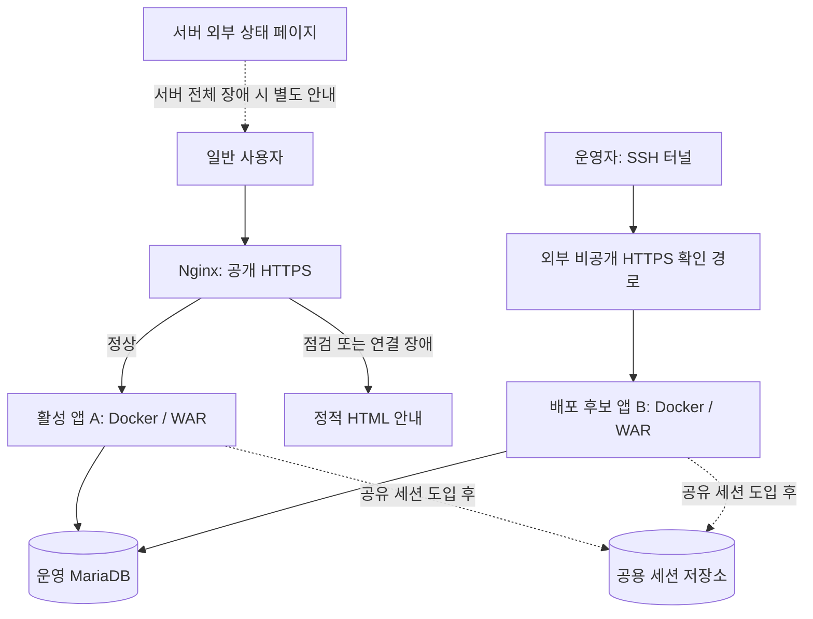

# 운영·점검·배포 설계

작성일: 2026-10-29. 상태: **설계 초안 작성 완료, 구현·기동·호스팅 검증 전**.

## 1. 목표와 현재 상태

사용자는 운영 DB를 연결한 새 버전을 먼저 본인이 확인하고 공개하는 흐름, 정기점검·갑작스러운 장애 안내, 향후 무정지 배포까지 직접 경험하기를 요청했다. 별도 테스트 DB에서의 사전 검증은 계속 필요하지만, 여기서 다루는 최종 확인 대상은 **실제 운영 DB를 사용하는 배포 후보 앱**이다.

현재 실행 WAR와 로컬 HTTP 시연용 Dockerfile/compose.yaml은 있다. 운영 Nginx, TLS, 점검 전환, 운영 후보 확인 경로, 공유 세션, 배포 자동화와 백업 복구는 구현하지 않았다. 기존 container 프로필은 Secure=false이고 prod와 혼용을 거부하므로 운영에 그대로 사용하지 않는다. 기존 92개 통과는 업무·보안 테스트 이력이며 아래 운영 시나리오의 검증 결과가 아니다.

이번에는 설계 문서만 작성한다. 서버 가입·결제·생성·배포·Docker 기동과 운영 DB 변경을 실행하지 않는다. 아래 경로·명령·코드는 실제 구현 후 확정하며, 없는 실행 스크립트를 사용 가능한 것처럼 안내하지 않는다.

## 2. 서버 업체와 자원 판단

업체와 무정지 배포 구조는 별개다. 일반적인 Linux VPS와 Docker를 쓸 수 있다면 DigitalOcean과 Contabo에 같은 구성을 적용할 수 있다. 업체 플러그인은 관리 수단이며 무정지 기능 자체를 제공하는 조건은 아니다.

| 후보 | 공식 확인 내용 | 이번 학습에서의 판단 |
|---|---|---|
| DigitalOcean Basic Regular 2GiB / 1 vCPU | 월 $12, SSD 50GiB | 앱 한 개 시연 기준. 현재 앱 제한 1200MB + DB 제한 512MB 외에 OS/Nginx가 필요해 두 앱 전환 기준으로 추천하지 않는다. |
| DigitalOcean Basic Regular 4GiB / 2 vCPU | 월 $24, SSD 80GiB | 잠깐 두 앱을 실행하는 실습의 시작 후보. 실제 RSS·부하를 측정하고 한도를 조정해야 한다. |
| Contabo Core Cloud VPS 4 | 공식 문서상 공유 4 vCPU / RAM 8GB / SSD 100GB | 저예산으로 여러 컨테이너·배포 겹침을 연습할 후보. CPU 숫자만으로 실측 성능을 보장하지 않는다. |

DigitalOcean 수치는 [공식 요금표](https://www.digitalocean.com/pricing/droplets), Contabo 사양은 [공식 VPS 문서](https://docs.contabo.com/docs/servers-hosting/vps/) 기준이다. 조회일은 2026-10-29다. Contabo [요금 페이지](https://contabo.com/en-us/pricing/)는 검색 결과와 직접 접근의 표시가 달랐고 직접 접근은 403이어서 통화·계약 기간·갱신·설치 비용까지 포함한 가격을 확정하지 않았다. [공식 지역 추가 요금 안내](https://help.contabo.com/en/support/solutions/articles/103000269774-what-is-the-location-fee-)상 일부 미국·아시아·호주 지역에는 추가 비용이 있다. 두 업체 모두 최종 지역/기간/세금/백업/트래픽 조건을 결제 전 확인한다.

권고: 무료 우선에서 소액 유료도 비교하는 현재 상황에서는 **Contabo의 최종 결제 견적을 먼저 비교**한다. 단기 실습·종료 조건과 비용 표시가 중요하고 월 $24를 수용하면 DigitalOcean 4GiB도 선택할 수 있다. 특정 업체의 안정성·지원 품질을 이번 조사로 보장하지 않는다. 공급자 선택·구매는 미확정이다.

4GiB는 권장 시작점이지 부하 검증 결과가 아니다. 현재 앱 메모리 제한을 두 개에 적용하면 2400MB, DB 512MB에 OS·Docker·Nginx·향후 세션 저장소가 더해진다. JVM의 Xmx는 전체 RSS가 아니다. 서버에서는 Maven 빌드를 하지 않고 CI에서 검증한 이미지를 받는다. Mac은 ARM64지만 선택 서버가 amd64면 해당 아키텍처 이미지가 필요하다. 향후 여러 앱을 상시 추가하면 8GB 이상을 별도 검토한다.

## 3. 목표 구조 — 먼저 단일 서버, 이후 확장

초기에는 Nginx를 호스트에 독립 설치하고 앱/DB를 Docker로 격리하는 안을 사용한다. 앱 컨테이너의 배포·종료가 Nginx를 내리지 않도록 하기 위해서다. Nginx 컨테이너도 가능하지만 이번 학습은 한 가지 안으로 시작한다.

- 공개 포트: 80(HTTPS 전환·인증서 발급에 필요한 경우), 443. SSH는 키 인증과 접속 정책으로 제한한다.
- 앱 A/B 예시: 호스트 127.0.0.1:18081 / 18082에 각각 연결. 앱 포트를 인터넷에 공개하지 않는다.
- MariaDB는 Docker 내부 네트워크에서만 접근하고 운영 데이터를 named volume에 보관한다. 앱 교체에서 DB 컨테이너·volume을 삭제하지 않는다.
- 평소 A 또는 B 하나만 활성화할 수 있다. 무정지 전환 때 후보를 추가로 실행하고 확인·전환·요청 종료 후 이전 앱을 정지한다.
- WAR는 버전별 Docker 이미지 안에 포함한다. 실행 중인 공유 WAR 파일을 덮어쓰지 않는다. 이미지 digest와 Git 커밋, 마이그레이션 버전을 배포 기록에 남긴다.
- 운영 앱은 명시적 prod 배포 설정을 사용한다. 컨테이너 내부 바인딩, Secure 쿠키, HTTPS 인식, 신뢰할 프록시를 새로 검증한다.

## 4. 사용자에게 보여 줄 상태

| 상태 | 일반 사용자 | 운영자 | 복구 조건 |
|---|---|---|---|
| 정상 | 활성 앱 | 활성 앱 확인 | 지속 모니터링 |
| 계획 점검 | 점검 HTML + HTTP 503 | 실제 앱/운영 DB 확인 가능 | 확인 후 명시적으로 공개 |
| 후보 확인 | 점검 HTML 또는 기존 앱 | 새 앱/운영 DB 확인 | 배포 검증 통과 |
| 앱 연결 장애 | 안전한 장애 안내 + 503 | 로그/DB/프로세스 조사 | 준비 상태 확인 후 복구 |
| 앱의 입력·권한·업무 오류 | 기존 한국어 오류 응답 | 추적 ID로 조사 | Nginx가 덮어쓰지 않음 |
| 서버 전체 장애 | 같은 서버의 Nginx도 응답 불가 | 공급자 콘솔/복구 | 외부 안내·백업 복구 |

계획 점검 모드와 장애 대체 응답은 구분한다. 계획 점검 해제는 앱이 뜨더라도 자동으로 하지 않는다. 점검 전환 시 새 POST도 앱에 보내지 않고 503으로 차단한다. 이미 앱에 도착한 거래는 완료·롤백을 확인한다.

프록시 연결 실패·타임아웃(502/504) 안내와 앱이 반환한 오류 계약을 구분하도록 Nginx를 구현한다. 모든 4xx/5xx를 공통 HTML로 치환하면 로그인·CSRF·입력 보존·JSON 계약이 깨질 수 있다. 앱이 반환한 SERVICE_UNAVAILABLE/추적 ID도 보존할 경로를 정한다. [Nginx proxy_intercept_errors/error_page](https://nginx.org/en/docs/http/ngx_http_proxy_module.html#proxy_intercept_errors)는 도구이며 구체적 분기와 실제 동작은 후속 테스트 대상이다.

안내 응답에는 Cache-Control: no-store를 적용한다. 예정 재개 시간이 확정됐을 때만 그 시간을 표시하며, 불명확한 장애에는 복구 시각이나 미설정 문의처를 만들지 않는다. Retry-After는 정당한 재확인 간격이 있을 때 사용하고 저장 요청 자동 재전송은 하지 않는다.

예시 문구:

- 점검: “서비스를 점검하고 있습니다. 잠시 후 다시 접속해 주세요.”
- 장애: “일시적으로 서비스를 이용할 수 없습니다. 저장 중이었다면 복구 후 처리 결과를 먼저 확인해 주세요.”

Nginx의 정적 HTML은 Java messages_ko.properties를 실행하지 못한다. 앱 밖 안내 문구도 USER_MESSAGES.md의 한국어·비노출 원칙을 따르고, 후속 구현 시 인프라용 코드/한국어 문구의 원본을 별도 관리한다. 요청값을 HTML에 삽입하지 않고 외부 폰트·CDN·DB에 의존하지 않는다. 프록시 발생 오류는 서버 생성 인프라 요청 ID를 사용하고 앱의 UUID와 구별한다. 요청 본문·쿼리·쿠키·세션/CSRF 토큰은 Nginx 로그에도 남기지 않는다.

## 5. 운영 DB를 연결한 비공개 배포 확인

확인 경로는 숨겨진 URL만으로 보호하지 않는다. 호스트 루프백에만 바인딩한 별도 Nginx HTTPS 리스너에 SSH 터널로 접근하는 안이다. 실제 도메인·인증서·브라우저 연결 방법은 서버 선택 후 확정하고 쿠키·리다이렉트·CSRF까지 검증한다. HTTP로 prod Secure를 끄거나 Security를 우회해 접속하지 않는다.

확인 경로도 Spring Security 로그인·역할·직원 객체 권한·CSRF를 모두 거친다. 공개 주소에서 헤더/쿼리로 점검 우회할 수 없게 한다. 검토용 호스트는 실제 TLS 인증서와 맞추고 허용 Host를 제한한다. Nginx는 외부 Forwarded/X-Forwarded-* 값을 신뢰하지 않고 검증한 값으로 덮어쓴다. 앱은 해당 프록시에서 온 값만 신뢰한다. 임의 헤더로 HTTPS·클라이언트 IP·로그인 제한을 우회할 수 없는지 검사한다.

공개 서비스가 계속되는 무정지 검토에는 실제 직원과 다른 **전용 운영 확인 계정**을 사용한다. 기존 계정으로 로그인하면 계정당 최대 1개 정책 때문에 그 직원의 기존 세션을 끊을 수 있다. 확인 계정에는 필요한 최소 역할만 준다.

기본 확인은 로그인·도서/거래처 목록·보고서·정적 자원·배포 버전·DB 읽기다. 임의 운영 주문을 생성/출고/반품하지 않는다. 쓰기 확인이 필요하면 합성 전용 자료와 승인된 시나리오를 사용하고 재고·원장·집계 영향과 정리 방법을 기록한다. 확인 주소가 달라도 같은 운영 DB이므로 자동 롤백이나 격리는 없다. 운영 DB에 CI 전체 테스트·demo 시드를 실행하지 않는다.

새 앱 기동은 Flyway·bootstrap·후속 예약 작업 때문에 접속 전에도 DB를 바꿀 수 있다. 따라서 “아직 공개 안 했으니 데이터 변경도 없다”고 가정하지 않는다. bootstrap은 최초 설치 후 비활성화하고, 백업/마이그레이션 승인을 후보 기동보다 먼저 둔다.

## 6. 배포 절차 A — 앱 하나와 안내 페이지

1. CI에서 업무/보안 테스트·이미지 검사. 이전/신규 이미지와 DB 변경 목록을 확보한다.
2. 백업을 외부 저장하고 복원 검증 이력·디스크 여유를 확인한다.
3. 공개 점검 모드를 켜고 새 변경 요청 유입을 차단한다. 처리 중인 거래가 정리되는지 확인한다.
4. 이전 앱을 정상 종료 신호로 내린다. SIGKILL·강제 컨테이너 삭제를 기본 절차로 쓰지 않는다.
5. 승인된 DB 마이그레이션을 별도 1회 실행한다. 실패하면 공개하지 않고 조사한다.
6. 새 앱을 실행한다. 운영 시작에서 반복 마이그레이션하지 않도록 배포 전용 실행과 앱 시작 정책을 구현한다.
7. SSH 확인 경로에서 운영 DB를 연결한 주요 기능을 확인한다.
8. 정상이면 점검을 해제하고 공개 주소의 HTTPS·로그인·조회·안내 해제를 다시 확인한다.
9. 실패하면 점검을 유지한다. DB 호환성이 확인된 경우에만 이전 이미지로 복구한다.

이 절차는 업무 기능에 점검 시간이 생긴다. 안내 제공과 무정지 업무 처리를 혼동하지 않는다. [Spring Boot graceful shutdown](https://docs.spring.io/spring-boot/reference/web/graceful-shutdown.html)에 맞춰 종료 대기와 Docker stop 유예를 명시하고 실제 요청으로 검증한다.

## 7. 배포 절차 B — 두 앱을 잠깐 겹쳐 전환

선행 조건은 충분한 메모리, 구/신 앱과 DB 호환성, 공유 세션 및 분산 로그인 폐기 검증이다.

1. A가 정상 서비스하는 동안 이전 버전과도 호환되는 DB 확장만 별도 실행한다.
2. 같은 운영 DB와 공용 세션 저장소를 사용하는 B를 새 이미지로 기동한다.
3. B 준비 상태·주요 화면·읽기 결과·보안 정책을 비공개 경로에서 확인한다. 실패하면 A는 유지한다.
4. 배포 실행을 직렬화하고 활성 대상 설정을 원자적으로 바꾼다. nginx -t 성공 후 reload한다. 검증 실패 시 기존 설정을 유지한다.
5. 기존 Nginx worker와 A의 진행 중 요청이 끝날 때까지 기다린다. reload 직후 A를 종료하지 않는다. keep-alive·장시간 요청·타임아웃 정책도 확인한다.
6. 공개 주소로 확인하고 A를 정상 종료한다. 메모리를 회수하되 이전 이미지는 보관한다.
7. 문제가 생기면 DB 호환성을 확인한 뒤 A 재기동·확인·연결 복귀 또는 점검 모드로 대응한다. A를 이미 정지했다면 즉시 복구된다고 보장하지 않는다.

[Nginx reload](https://nginx.org/en/docs/control.html)는 기존 연결을 처리할 worker를 남긴다. 이것이 모든 업무 요청·세션·DB 변경의 무중단을 자동 보장하지는 않는다. 새 요청과 기존 요청의 버전이 잠시 섞일 수 있어 세션 형식·정적 자원에도 호환성을 유지한다. 변경 JS/CSS는 버전 경로/해시를 사용하고 이전 파일을 전환 동안 유지하는 안을 후속 검증한다.

단일 VPS에서의 앱 배포 중단 최소화가 목표다. 호스트·Nginx·DB가 하나이므로 서버 장애나 DB 재시작까지 무정지인 고가용성 구성은 아니다. 다른 서비스의 컨테이너도 그 호스트 장애에는 함께 영향을 받는다.

## 8. 공유 세션은 라이브러리 추가 이상의 변경

[Spring Session](https://docs.spring.io/spring-session/reference/)은 Redis 또는 관계형 DB 같은 공용 저장소에 세션을 보관할 수 있다. Redis만 유일한 방법은 아니다. 이번 목표는 Redis 기반을 우선 후보로 두되 비용·직렬화·운영 복잡도를 실제 구현 단계에서 비교한다. 저장소 선택·라이브러리 버전은 아직 확정하지 않는다.

현재 소스에서 확인한 단일 JVM 의존성:

- SecurityConfiguration: SessionRegistryImpl과 synchronized(registry)의 로그인 직렬화.
- LiveSessions: JVM 안의 HttpSession 참조로 즉시 invalidate.
- SessionRevocation: JVM 레지스트리를 조회하여 세션 폐기.
- SessionGuardFilter: 레지스트리 항목이 없으면 세션을 거부한다. 공유 세션 데이터만 복원해도 이 검사를 통과하지 못한다.

후속 구현은 공용 저장소 기반 세션 조회·삭제, 계정당 최신 로그인 원자적 결정, 두 앱의 동시 로그인 경쟁과 폐기 이벤트, 저장소 장애 시 보호 요청 거부까지 포함한다. DB auth_version/enabled/role의 매 요청 검사, 30분 미사용·8시간 절대 만료와 CSRF 정책은 유지한다. ErpPrincipal과 인증 객체의 직렬화·구/신 버전 호환성도 검증한다. 세션·토큰을 로그로 출력하지 않으며 공유 저장소를 공개하지 않는다.

이 작업 전에는 “로그인이 유지되는 무정지 배포 완료”로 표시하지 않는다. 기존 로컬 세션에서 공유 방식으로 처음 바꾸는 배포에는 재로그인이 필요할 수 있으므로 별도 안내·검증한다.

## 9. DB 변경과 롤백

- 컬럼/테이블 추가 → 구/신 코드 공존 → 데이터 이관 → 후속 배포에서 구 컬럼 제거 순서로 진행한다. 기본값·NULL·인덱스와 DDL 잠금 시간을 검토한다.
- 후보 앱이 구 앱과 공존하는 동안 컬럼 삭제·호환 불가 타입 변경을 하지 않는다. MariaDB DDL은 업무 트랜잭션처럼 모두 되돌아간다고 가정하지 않는다.
- Flyway 버전 적용 이력·checksum은 유지하고 적용된 파일을 덮어쓰지 않는다. 마이그레이션 실행 계정과 일반 앱 계정의 권한을 분리하는 것을 목표로 한다.
- 새 앱의 운영 DB 쓰기는 공개 전이라도 실제 변경이다. 앱 롤백은 그 쓰기를 취소하지 않는다.
- 백업 복원은 이후 정상 업무 기록까지 되돌릴 수 있다. 복원 범위·손실 가능성·대사 계획을 확인하고 쓰기를 중단한 상태에서 수행한다. 장애마다 자동 DB 복원을 실행하지 않는다.
- DB 변경이 호환되지 않으면 무정지를 고집하지 않고 점검 배포로 전환한다.

## 10. 서버 장애·관측·백업

Nginx의 장애 페이지는 앱만 내려간 경우에 유효하다. VPS 전원/네트워크/Nginx가 중단되면 같은 장비는 안내하지 못한다. 서버 외부의 정적 상태 페이지와 외부 HTTP 모니터를 후속 단계로 둔다. 원래 도메인에 자동 장애 화면을 제공하려면 해당 기능을 지원하는 외부 프록시/엣지 서비스와 요금·동작 검증이 추가로 필요하다. 단순 DNS 변경은 캐시 때문에 즉시 전환을 보장하지 않는다. CDN이 모든 장애에 자동으로 안내 HTML을 보여 준다고 가정하지 않는다.

모니터 대상은 공개 HTTPS, 준비 상태, DB 연결, CPU/RSS/디스크, 재시작/OOM, 5xx 비율, 인증서 만료, 백업 성공/최근 복원 시각이다. DB/공유 세션 저장소 장애인 앱에는 트래픽을 전환하지 않는다. 준비 상태 경로는 내부 전용의 최소 응답으로 만들고 SQL·계정·환경 정보를 노출하지 않는다. 현재 /health를 외부에 익명 공개하는 변경은 하지 않는다.

일일 DB 논리 백업과 배포 전 백업을 암호화해 서버 외부에 보관하는 것을 초기안으로 한다. 권한 제한·보관 기간·실패 알림을 정하고 별도 빈 DB에 복원하여 주문/재고/원장/보고서 합계를 대사한다. 여러 테이블의 일관성을 보장하는 백업 옵션과 DDL 동시 실행 제한을 검증한다. Docker volume이나 같은 서버의 스냅샷만으로 외부 백업을 대체하지 않는다. 세션 저장소는 업무 DB 백업과 다른 복구 정책이며 복원 시 재로그인 처리를 검토한다.

학습 목표로 RPO(복구 시 허용 데이터 손실) 24시간 이내, RTO(복구까지 시간) 60분 이내를 가정한다. 배포 시점 백업은 별도로 둔다. 이는 측정 전 목표이고 달성 보장이 아니다. 실제 요구가 더 엄격하면 binlog 기반 시점 복구·DB 분리·다중 호스트를 추가 검토한다. 알림 연락처/외부 모니터 계정은 미설정이며 사용자를 대신해 메시지 발송·정기 작업을 생성하지 않는다.

## 11. 구현 순서와 완료 기준

이해 확인 전 다음 구현 단계로 자동 진행하지 않는다. 첫 실습은 서버 구매 전 로컬의 작은 점검 안내 단위로 제한할 수 있다.

| 단계 | 구현할 것 | 반드시 실제로 확인할 것 |
|---|---|---|
| O1 | Nginx + 한국어 정적 점검/장애 안내 | 앱 중단 중 HTML 503, POST 미전달, 업무 4xx 보존, 재시도 자동 전송 없음 |
| O2 | prod HTTPS/쿠키·신뢰 프록시·비공개 확인 | 외부 확인 경로 차단, 터널 로그인/CSRF, 헤더 위조 거부, 로그 비노출 |
| O3 | 버전 이미지·준비 상태·점검 배포/복구 | 새 버전 실패 시 점검 유지, 기존 거래 종료, 버전/DB 호환 롤백 |
| O4 | 공유 세션·분산 로그인 폐기 | A 로그인→B 접근 유지, 동시 로그인 새 로그인만 유효, 차단/비밀번호/30분/8시간/CSRF |
| O5 | 블루·그린 전환 | 실제 HTTP 연속 요청, A 진행 요청 drain, B 실패 시 무전환, 기존 세션 유지·신버전 자원 호환 |
| O6 | 외부 안내·관측·백업 복구 | 호스트 장애를 외부에서 감지, 독립 안내, 외부 백업→빈 DB 복원·업무 대사·소요 시간 기록 |

O1~O6은 모두 미구현이다. MockMvc는 앱 계약 검사에 사용하고 Nginx/TLS/Docker/두 프로세스 전환/백업은 실제 통합 검사로 검증한다. CI는 기존 Java/비밀정보 검사 외에 이미지 스캔·Nginx 구문·실제 통합 검사로 확장하되, 미작성 워크플로를 연결 완료로 표시하지 않는다.

계획 파일 역할(아직 생성하지 않음): deploy/nginx/는 프록시·안내 경로, deploy/pages/는 정적 한국어 문구, 운영 Compose는 A/B와 비공개 DB/세션 네트워크, scripts/deploy/는 잠금·사전 검사·전환·복구를 담당한다. 기존 로컬 compose.yaml은 학습용으로 보존한다.

## 12. PHP 비교와 학습

PHP에서 Nginx가 maintenance.html을 제공하고 PHP-FPM/DB를 별도로 운영하는 것과 같은 분리다. Spring은 실행 중인 WAR 프로세스가 있으므로 버전 교체 때 프로세스 준비·종료가 필요하다. 공용 세션은 PHP의 세션 파일을 특정 서버에만 두는 대신 공용 DB/Redis에 보관하는 개념과 비슷하다. 두 경우 모두 계정 동시 로그인과 권한 검사는 별도 유지해야 한다.

직접 수정 과제 **1개**: 이 문서의 점검 안내 예시 문구 한 개를 원하는 한국어 문장으로 수정한다. 확정되지 않은 복구 시각이나 가짜 문의처는 추가하지 않는다. 이 과제는 문서 수정이며 실제 페이지 반영은 아니다.

이해도 확인 **3개**:

1. Spring Boot 앱이 꺼져 있을 때 점검 HTML은 누가 보여 주며, DB 연결이 필요한가?
2. 비공개 확인 경로에서 도서를 수정하면 운영 DB에 반영되는가?
3. 앱 두 개를 같은 VPS에 실행하면 VPS 전체 장애에도 업무 서비스가 계속되는가?

## 이번 설계의 검증 한계

저장된 Dockerfile/Compose/prod 설정·세션 코드를 읽고 설계와 현재 구현의 차이를 확인했다. 문서 diff·상대 링크·필수 항목을 검사한다. 이번 작업에서는 앱·Docker·Nginx·실제 서버·새 부하/세션/복원 테스트를 실행하지 않는다. 기존 92개 테스트를 재실행했다고 보고하지 않는다.
