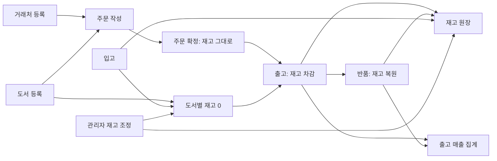
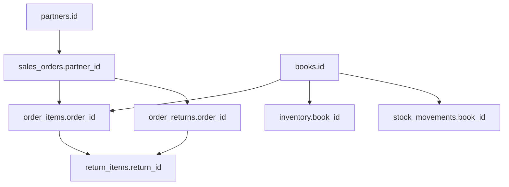

# 출판 ERP Mini — 구조·업무·키·JSP 변경 안내

기준일: 2026-11-01. 현재 소스를 읽어 정리한 학습·면접 준비 문서다. 새 기능 구현이나 실서비스 운영 실적이 아니다. 파일 경로는 저장소 루트 기준이다.

후속 [쇼핑몰 주문 수신 설계](MALL_ORDER_DESIGN.md)는 기존 books.id를 공유하는 B2C 규격으로 채택했다. 현재 아래 구현 설명과 구분하며 API/배송/공급처 기능은 아직 추가하지 않았다.

## 1. 지금 기능을 더 추가해야 하는가?

이번 포트폴리오의 정한 업무 범위는 구현돼 있다. 도서·거래처 관리에서 주문·출고·반품·재고·매출 보고서까지 연결되고 로그인/권한/세션·공통 오류·보안 검사가 있다. 새로운 업무 기능을 계속 늘리는 것보다 이 연결을 설명하고 작은 수정을 검증하는 연습을 우선한다. 지원 준비는 공개 배포와 병행할 수 있다.

완성된 상용 ERP 전체라는 뜻은 아니다. 회계/세금계산서/실결제·환불/매입·발주/다중 창고/배송사 연동은 이번 범위에 없다. 단순 재고 입고를 매입·발주 시스템이라고 설명하지 않는다. 필요성 없이 지금 추가하지 않는다.

인터넷 공개 전에는 운영 HTTPS/프로필, DB 최소 권한, secret/초기 계정 정책, 완성 컨테이너 빌드·기동/포트 검사, 외부 백업 복원을 검증해야 한다. Nginx 점검 안내·무정지 전환·공유 세션은 OPERATIONS_DESIGN.md의 설계 단계이고 아직 구현되지 않았다. 지원서에 운영/무정지 배포 완료라고 적지 않는다.

최신 실행 검증은 Temurin 21.0.13+9에서 자동 테스트 93개·WAR 성공(2026-10-31)이다. 이번 설명 작업에서는 이를 재실행하지 않았다. 원격 main은 기존 92개 테스트이며 추가 SQL Injection 검사·최근 문서/Java 선택 변경은 아직 로컬 작업 사본에 있다. GitHub 제출본과 현재 로컬을 같다고 가정하지 않는다.

## 2. 한 문장 설명과 전체 흐름

> 도서와 거래처를 기준정보로 관리하고, 주문의 출고·반품을 재고 및 변경 이력과 같은 트랜잭션으로 처리한 뒤 출고·반품 기록으로 매출을 집계하는 Spring MVC 웹 애플리케이션입니다.



화면을 여는 것과 업무를 확정하는 것은 다르다. GET 목록/폼은 조회이고 실제 등록·출고·반품·조정은 CSRF가 있는 POST로 처리한다.

## 3. 기능별 역할·연결

| 기능/주소 | ERP에서 하는 작업 | 읽고/바꾸는 핵심 데이터 | 연결되는 다음 기능 |
|---|---|---|---|
| 로그인 /login | 직원 인증과 권한 확인 | erp_users, login_attempts, 서버 메모리 세션 | 모든 보호 화면·업무 |
| 도서 /books | ISBN·제목·저자·출판사·발행일·정가, 검색/수정/비활성화 | books, 신규 등록 때 inventory 0행 | 입고·주문 품목·재고·집계 |
| 거래처 /partners | 서점/유통사, 코드·연락처 등 관리 | partners | 주문의 거래처 선택 |
| 재고 입고 /inventory/receipts | 도서별 들어온 수량을 더함 | inventory 증가, stock_movements 추가 | 출고 가능한 재고 확보 |
| 주문 /orders | 거래처와 1~20개 도서/수량/단가 선택 | sales_orders, order_items | 확정·취소·출고 |
| 주문 확정 | DRAFT를 CONFIRMED로 변경 | sales_orders.status만 변경 | 출고 준비, 아직 예약/차감 아님 |
| 출고 | 확정된 주문의 도서 수량을 차감 | inventory·stock_movements·주문 상태/출고 시각 | 매출·반품 |
| 취소 | 작성/확정 상태의 주문을 취소 | sales_orders.status=CANCELLED | 출고되지 않아 재고 복원 없음 |
| 반품 | 출고한 품목 일부/전체를 돌려받음 | order_returns·return_items·품목 누적 반품량·재고·원장 | 재고 복원·반품일 매출 차감 |
| 재고 조정 /inventory/adjustments | 실사 차이 등에 따라 수량 증감, 사유 필수 | inventory, stock_movements | ADMIN만 처리, 매출 거래는 아님 |
| 재고/원장 /inventory, /inventory/movements | 지금 몇 권인지/왜 바뀌었는지 조회 | inventory와 books, stock_movements | 수량 대사·업무 추적 |
| 보고서 /reports/sales | 월별·도서별·거래처별 매출, 현재 부족 재고 | 출고 주문·품목과 반품 기록, 현재 재고 | 업무 현황 확인 |
| 계정 /admin/users | 직원 계정 생성·차단 | erp_users | ADMIN 전용, 세션 폐기 |
| 비밀번호/프로필 | 본인 암호 변경, 본인/ADMIN 프로필 조회 | erp_users와 세션 | 계정 보호·객체 접근 권한 |
| 공통 오류 | 수정할 입력/문제·추적 ID 안내 | ErrorCode·메시지·로그, 입력 model | SQL/Stack Trace/비밀번호 비노출 |

도서/거래처의 비활성화는 DELETE가 아니라 active=false다. 과거 주문이 참조하던 도서/거래처를 보존하고 새 주문 선택에서는 제외한다. 현재 구현이 비활성화된 도서의 과거 확정 주문 출고를 전부 막는 정책은 아니므로 범위를 과장하지 않는다.

## 4. 키를 이해하는 방법

- **PK(기본키)**: 그 테이블에서 한 행을 구별하는 번호. books.id=25는 25번 도서다.
- **FK(외래키)**: 다른 테이블의 PK를 참조하는 칸. order_items.book_id=25면 25번 도서를 주문한 행이다.
- **UNIQUE(중복 금지)**: PK와 별도로 중복을 막는 제약. ISBN/거래처 코드/주문번호 등이 해당한다.
- **업무 번호와 내부 번호**: 주문번호 order_no는 사용자 식별용, sales_orders.id는 관계 연결용이다. 화면 URL /orders/101의 101은 현재 내부 id다.
- **요청 키**: request_key/operation_key는 같은 처리가 반복 저장되는 것을 막는다. 로그인 세션·CSRF 토큰과 역할이 다르다.
- **이름/제목**: 표시용이다. 같은 이름이 있거나 이름이 변경될 수 있어 연결 기준으로 쓰지 않는다.

| 테이블 | 기본키 | 연결하는 키 | 그 행이 뜻하는 것 |
|---|---|---|---|
| books | id | 다른 테이블이 book_id로 참조 | 도서 한 종 |
| partners | id | sales_orders.partner_id가 참조 | 거래처 한 곳 |
| inventory | **book_id** | books.id, PK이면서 FK | 도서 한 종의 현재 수량. 별도 inventory.id는 없음 |
| sales_orders | id | partner_id → partners.id, created_by → erp_users.id | 주문 한 건의 거래처/상태/총액 |
| order_items | id | order_id → sales_orders.id, book_id → books.id | 주문에 들어간 도서 한 종과 수량/단가 |
| stock_movements | id | book_id → books.id, actor_id → erp_users.id | 수량이 바뀐 사건 한 건 |
| order_returns | id | order_id → sales_orders.id, actor_id → erp_users.id | 특정 주문의 반품 처리 한 건 |
| return_items | id | return_id → order_returns.id, **order_item_id → order_items.id** | 이번 반품의 정확한 원주문 품목과 수량 |
| erp_users | id | created_by/actor_id가 참조 | 직원 계정 한 개 |
| login_attempts | bucket_key | 직접 FK 없음 | 계정/IP 입력을 해시한 시도 제한 버킷. 로그인 세션 테이블이 아님 |

중복 제약: books.isbn은 선택이며 입력하면 유일, partners.code/erp_users.username/order_no/request_key/operation_key는 유일하다. order_items는 (order_id, book_id), return_items는 (return_id, order_item_id) 조합이 유일하다. 즉 같은 도서는 같은 주문에 두 줄 대신 한 줄 수량으로 다룬다.

stock_movements.reference_type/reference_id는 출고 ORDER이면 주문 id, 반품 RETURN이면 반품 id다. 입고 RECEIPT/재고 조정 ADJUSTMENT의 reference_id는 현재 도서 id다. 여러 종류를 가리키므로 reference_id는 DB FK가 아니다. 현재 별도의 입고 전표 테이블이 있다는 뜻으로 해석하지 않는다. 원장 자체의 PK인 id, 참조 번호, 중복 방지 키는 서로 다른 칸이다.



화살표는 참조 관계 개념도다. 정확한 컬럼과 제약은 위 표와 [실제 ERD](erd.md), V1~V3 마이그레이션 SQL을 본다.

## 5. 숫자로 따라가는 업무 예제

아래 id/수량은 이해를 위한 가정이며 실제 DB를 수정한 결과가 아니다. 도서 25번 ‘자바 입문’, 거래처 7번 ‘가상서점’, 단가 18,000원, 같은 집계 기간이라고 하자.

| 순서 | 처리와 연결 | 현재 재고 | 매출에 미치는 영향 |
|---|---|---:|---:|
| 1 | books.id=25 등록 → inventory.book_id=25 생성 | 0 | 없음 |
| 2 | 도서 25에 10권 입고 → 원장 quantity=+10 | 10 | 없음 |
| 3 | 주문 101 작성: partner_id=7. 품목 501: order_id=101, book_id=25, quantity=3, unit_price=18000 | 10 | 아직 없음 |
| 4 | 주문 101 확정 CONFIRMED | 10 | 아직 없음 |
| 5 | 주문 101 출고 FULFILLED → 원장 -3, fulfilled_at 기록 | 7 | 출고 매출 54,000원 |
| 6 | 반품 301, order_id=101. 반품 품목은 return_id=301, order_item_id=501, quantity=1 | 8 | 반품액 18,000원 차감, 순매출 36,000원 |
| 7 | 실사 수량이 6권이면 ADMIN이 -2 조정·사유 기록 | 6 | 재고 조정이므로 매출은 그대로 |

현재 재고는 0+10-3+1-2=6권. 원장은 +10/-3/+1/-2의 이력을 보관한다. 현재 재고 숫자만 UPDATE하고 원장을 빼먹지 않도록 StockLedger가 함께 처리한다.

반품이 다음 달이면 첫 달 출고 매출은 54,000원, 다음 달 반품 차감은 18,000원이다. 다음 달에 출고가 없으면 순매출이 -18,000원일 수 있다. 실제 결제/현금 환불을 실행한 것은 아니다.

## 6. 주문 상태와 재고를 따로 기억한다

```text
DRAFT(작성) → CONFIRMED(확정) → FULFILLED(출고 완료)
    └─ 취소 가능 ──┐
CONFIRMED ────────┴→ CANCELLED(취소)

FULFILLED → 부분/전체 반품 기록 추가
          상태는 FULFILLED 유지
```

CONFIRMED는 재고 예약이 아니다. 여러 확정 주문의 수량 합계가 재고보다 많을 수 있고 출고 시 실제 재고를 확인한다. 출고 후 cancel은 허용하지 않는다. 반품 가능량은 order_items.quantity-returned_quantity이고 남은 수량을 넘길 수 없다.

## 7. 데이터가 틀어지지 않게 하는 핵심 설계

### 같은 트랜잭션

출고는 재고 차감, 원장 INSERT, 주문 상태/시각 변경이 함께 성공하거나 함께 취소돼야 한다. OrderService.fulfill의 @Transactional이 경계이고 StockLedger.apply의 MANDATORY는 이미 시작된 그 거래에 참여하도록 한다. 여러 품목 중 하나라도 실패하면 앞서 차감한 품목도 롤백한다. PHP PDO에서 같은 연결의 beginTransaction/commit/rollBack으로 묶는 것과 같다.

### 동시에 요청할 때 잠금과 중복 검사

주문 행과 재고 행을 FOR UPDATE로 잠가 같은 재고의 동시 출고를 직렬화한다. 도서 id 순서를 통일해 교착 가능성을 줄인다. 이미 출고된 주문은 상태 검사로 거부하고 DB UNIQUE 처리 키로 중복 원장도 방어한다. 브라우저 버튼을 비활성화하는 것만으로 데이터 중복을 막지 않는다.

### 단가·명칭 보존과 금액 계산

주문에는 당시의 book_title/partner_name/unit_price를 복사한다. 단가 미입력 시 현재 정가를 기본값으로 쓰며 입력한 유효 단가도 허용한다. 서버가 수량×단가와 합계를 계산하고 범위를 검사한다. 정가를 나중에 바꿔도 과거 주문/반품 단가는 달라지지 않는다. 원 단위 정수로 저장하고 보고서 SUM은 BigDecimal로 받는다.

### FK 외에도 업무 검사가 필요

return_items.order_item_id FK는 그 주문 품목이 존재하는지 보장한다. 그 품목이 지금 반품하는 주문의 품목인지까지 단일 FK로 보장하지 않으므로 Service가 주문 소속을 검사한다. 이는 직원 프로필의 본인/ADMIN 접근 검사와 다른 종류의 업무 검증이다.

## 8. 브라우저 요청과 파일 역할

```text
브라우저 GET/POST
 → Security 필터: 로그인·세션·권한·CSRF
 → Controller: 주소 연결·입력 바인딩/검증·화면 선택
 → Service: 업무 규칙·권한·트랜잭션
 → Mapper.java: Java에서 호출할 SQL 메서드 계약
 → Mapper.xml: 바인딩 SQL 실행
 → MariaDB
 → Java 결과 객체 → Controller의 Model → JSP → HTML
```

Security가 거부하면 업무 Controller/SQL까지 가지 않는다. Mapper 인터페이스와 XML namespace/id를 MyBatis가 연결한다. Model은 JSP에 넘길 이름 붙인 데이터이며 DB 테이블이 아니다. JSP는 화면 렌더 도구이고 SQL 실행 장소가 아니다.

| 실제 파일/폴더 | 담당 | PHP에서 비교할 부분 |
|---|---|---|
| src/main/java/com/portfolio/erp/ErpApplication.java | Spring Boot 앱 시작 | 프레임워크 부트스트랩 |
| book/BookController.java | /books 요청과 Model, book/list·book/form 선택 | 라우터가 부른 컨트롤러 |
| book/BookForm.java, common/PageQuery.java | 입력 형식·제약, 검색·페이지 조건 | 요청 DTO/입력 검증 |
| book/BookService.java | 도서 등록+초기 재고, 수정·비활성화 업무 | 업무 함수/서비스 |
| book/BookMapper.java + resources/mapper/BookMapper.xml | SQL 계약과 SELECT/INSERT/UPDATE | PDO prepared statement |
| book/Book.java, common/PageResult.java | DB 결과와 목록·전체 건수·페이지 묶음 | 결과 객체/배열 |
| webapp/WEB-INF/jsp/book/list.jsp, form.jsp | 목록과 등록/수정 폼 표시 | escaping한 템플릿 |
| order/OrderController.java, OrderService.java, OrderMapper.java/XML | 주문·상태·출고·반품 | 컨트롤러+업무+SQL |
| inventory/InventoryService.java, StockLedger.java, InventoryMapper.java/XML | 현재 수량·원장 변경 | 공용 재고 처리 업무 함수 |
| report/ReportController.java, ReportService.java, ReportMapper.java/XML | 날짜 검증과 읽기 집계 | 통계 조회 기능 |
| security/ | 로그인·사용자 조회·권한·세션 | 공통 인증 미들웨어/세션 처리 |
| common/error/ + messages*.properties | 안전한 오류 문구·추적 ID·같은 폼 | 공통 오류 처리/번역 |
| resources/db/migration/ | 순서 있는 DB 설치/변경 | 버전 관리된 SQL 마이그레이션 |
| resources/application*.yml | DB 연결·JSP 위치·프로필/쿠키 등 | 환경별 설정 |
| resources/static/css, static/js | 디자인·브라우저 동작 | CSS/jQuery |

표에서 book/ 등 짧은 Java 경로는 src/main/java/com/portfolio/erp/ 아래다. resources/와 webapp/은 src/main/ 아래다.

실제 도서 목록 코드는 다음과 같다.

```java
model.addAttribute("result", service.list(query));
return "book/list";
```

application.yml의 prefix/suffix가 붙어 /WEB-INF/jsp/book/list.jsp가 선택된다. JSP가 result.items를 반복 출력하며 result.total은 검색 전체 건수다. 한 페이지 10행과 검색 전체 건수는 다르다.

등록 요청 예시:

```text
GET /books/new → 빈 BookForm → book/form.jsp
POST /books → BookForm 바인딩·검증
  실패: 같은 폼과 안전한 입력/오류를 반환
  성공: BookService → books INSERT + inventory INSERT → commit
       → redirect:/books → 브라우저가 GET으로 목록 조회
```

request path id, form의 필드 name, modelAttribute, Java 속성, DB 컬럼은 같은 개념이 아니다. 예를 들어 form:input path="title"은 Form의 title, /books/25의 25는 수정 대상 id, books.title은 Mapper가 저장하는 DB 컬럼이다. 각 연결을 확인해야 한다.

## 9. JSP만 수정하면 되는가?

**이미 준비된 데이터의 표시만 바꾸면 보통 JSP/CSS/JS 범위다. 데이터·검증·업무 규칙을 바꾸면 서버와 SQL도 함께 검토한다.**

| 요청받은 변경 | 수정 범위 | 왜 그런가? |
|---|---|---|
| ‘저장’ 버튼을 ‘도서 저장’으로 변경 | JSP | 표시 문자열만 변경 |
| 색/여백/화면 배치 변경 | CSS·필요한 JSP | 데이터 계약은 동일 |
| 이미 전달된 정가를 목록에 표시 | JSP(전달 여부 먼저 확인) | Model 결과에 listPrice가 있음 |
| 목록에 아직 조회하지 않는 통계 추가 | SQL/Mapper·결과 객체·Service/Controller·JSP 중 필요한 부분 | DB에서 가져오거나 계산할 데이터가 새로 필요 |
| 기존 표시 항목 순서 변경 | JSP/CSS | 정렬 SQL 변경과 화면 칸 순서 변경은 다름 |
| 최신순을 가격순으로 검색 정렬 변경 | Query·허용 정렬 값·SQL·필요한 UI/테스트 | 화면 행을 옮기는 것이 아니라 전체 결과 정렬 |
| 도서 분류를 새로 저장 | Flyway 새 SQL·Form/객체·바인딩 허용·Mapper·Service·JSP·테스트 | 새 저장 항목의 전체 경로 필요 |
| 정가 최대 허용값 변경 | Java 검증·업무 규칙·DB CHECK·JSP min/max·테스트 | HTML 제한만 바꾸면 서버/DB 제한과 불일치 |
| 출고를 ADMIN만 가능하도록 변경 | Security URL·Service 권한·버튼 표시·테스트 | 버튼 숨김만으로 POST 호출을 막지 못함 |
| 확정 시 재고 예약으로 변경 | 업무/DB·상태·잠금·출고/취소·테스트 전체 영향 분석 | 현재 비예약 설계의 변경 |
| 오류 안내 문구 수정 | messages_ko.properties와 기본 messages.properties | JSP가 공통 메시지를 출력 |
| 품목 행 추가/삭제 버튼 동작 변경 | order-form.js·JSP, 서버 항목 한도 변경 시 Java도 | 브라우저 편의와 서버 검증은 별개 |

필드의 화면 라벨과 name/path는 구분한다. 라벨은 자유롭게 바꿔도 title이라는 path를 bookTitle로 임의 변경하면 기존 Java 바인딩이 끊길 수 있다. CSRF hidden 토큰, requestKey, POST action도 디자인 변경 중 삭제하지 않는다. HTML 출력 이스케이프를 유지한다.

### 개발 반영과 운영 반영도 구분

- 현재 소스 실행: ./scripts/run.sh로 실행 중이고 local/demo 설정이면 JSP 저장 후 새로고침 시 재컴파일한다. CSS/JS 변경은 브라우저 캐시도 확인한다.
- Java 클래스 변경: 소스 수정만으로 실행 JVM의 모든 클래스가 바뀐다고 가정하지 않는다. 현재 실행 방식에 따라 컴파일·앱 재시작이 필요하다.
- 현재 messages 파일은 앱 리소스다. 개발 중 리소스 복사/재시작을 확인하고 운영 WAR는 재빌드한다. 실시간 외부 메시지 갱신 구성으로 설명하지 않는다.
- 현재 실행 WAR: **JSP만 수정한 변경이라도 WAR 내부 파일을 바꾸려면 재빌드·배포가 필요하다.** 소스 폴더를 고쳐도 기존 WAR는 그대로다. 외부 JSP/콘텐츠 파일을 읽는 구성은 현재 구현하지 않았다.
- Docker: WAR가 포함된 새 이미지를 만들고 앱 컨테이너를 교체한다. Nginx 안내/두 앱 전환은 별도 운영 설계이며 지금 자동 무정지가 되는 것은 아니다.

‘수정하는 소스가 JSP뿐’이라는 것과 ‘운영 서버에 파일 하나만 덮어쓰면 된다’는 것은 다른 말이다.

## 10. 보고서·보안에서 말할 수 있어야 할 점

보고서는 별도 매출 테이블에 금액을 다시 쓰지 않고 출고 주문/품목과 반품 전표/품목을 UNION ALL로 모아 집계한다. 출고일 매출−반품일 반품액이다. 도서/거래처 순매출 순위는 상위 20개이며 상위 합계를 전체 합계로 오해하지 않는다. 부족 재고는 현재 시점이고 날짜별 과거 재고 보고서가 아니다.

ADMIN은 계정·재고 조정 포함 전체, MANAGER는 주문/입고/출고/반품·기준정보 변경, USER는 공통 업무 조회다. 본인 비밀번호 변경은 로그인 사용자에게 제공한다. 메뉴를 숨기는 것과 실제 URL/Service 권한 검사는 다르다. 현재 세션은 단일 JVM이고 30분 미사용/최대 8시간·최신 로그인만 유지한다. 비밀번호 변경·계정 차단 때 기존 세션을 폐기한다.

## 11. 취업 준비에서 먼저 정리할 내용

기능 확장 대신 아래 다섯 가지를 자료로 만든다.

1. **2~3분 시연**: 도서/거래처 → 입고 → 주문/확정 → 출고 → 부분 반품 → 보고서. DEMO.md의 합성 자료만 사용한다.
2. **핵심 설명 3개**: 한 품목 실패 시 출고 전체 롤백, 동시 요청/중복 처리 방지, 과거 단가로 반품하는 이유.
3. **실제 유지보수 경험**: PHP·Android·iOS에서 어떤 문제를 맡아 무엇을 수정하고 어떻게 확인했는지 실제 사례를 적는다. 기간/성과/언어는 추정하지 않는다.
4. **검토 가능한 제출본**: 아직 로컬인 변경을 정리·검증하고 GitHub 제출 상태와 일치시킨다. 저장소는 비공개라 채용 담당자 접근 방법을 정해야 한다. 공개 전환은 별도 결정이다.
5. **사실에 맞는 범위**: DB는 MariaDB, 실서비스 운영·무정지 구현은 미완료, 자동 테스트 93개는 운영 사용자 수가 아니다. AI 도움과 직접 수정/설명 가능한 부분을 구분한다. 지원 공고가 정해지면 APPLICATION_DRAFT.md를 실제 경력과 연결한다.

면접용 요약 예시:

> PHP 웹·모바일 앱 유지보수 경험을 바탕으로 Spring MVC를 학습하며 출판 ERP를 구성했습니다. Controller·Service·MyBatis SQL·JSP의 책임을 나눴고, 출고와 반품에서 재고·원장·상태가 함께 반영되도록 트랜잭션과 행 잠금을 사용했습니다. 실제 MariaDB·JSP HTTP·보안 회귀를 포함한 93개 자동 테스트로 확인했습니다. 현재 코드를 설명하고 수정하는 연습과 공개 배포 준비를 진행하고 있습니다.

이는 사용자가 이해한 범위와 실제 역할에 맞게 조정할 초안이다. 직접 처음부터 전부 작성했다고 주장하는 문구로 바꾸지 않는다.

## 12. 이번 학습의 수정 과제 1개와 질문 3개

**과제 1개:** 이 문서의 5번 숫자 예제 아래에 ‘출고 3권 중 2권을 반품했다면’의 최종 재고와 순매출을 본인 계산으로 한 줄 추가한다. 7번 실사 조정은 적용하기 전 기준으로 계산하며 앱/DB는 바꾸지 않는다. Codex가 답을 대신 기록하지 않는다.

1. 주문 한 건의 도서 목록을 찾을 때 order_items의 어느 컬럼을 sales_orders.id와 연결하는가?
2. 도서 2개를 출고하다 두 번째 도서의 재고가 부족하면 첫 도서 재고는 어떻게 돼야 하는가?
3. ‘저장’ 버튼 문구를 바꾸는 일과 ‘도서 분류’를 새로 저장하는 일은 수정 파일 범위가 어떻게 다른가?

이번 생성물은 설명 문서이며 업무 코드·DB·서버·실행 방식 변경은 없다. 기존 Java 패치 복습 3개는 사용자 정답을 확인했으나 별도 기록 수정 과제 수행은 확인하지 않았다. 이번 전체 구조 이해도도 문서 작성만으로 완료 처리하지 않는다.
