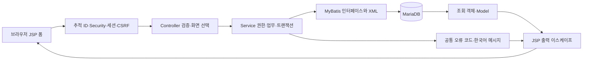

# 구조와 실행 흐름

Java 21 / Spring Boot 4.1.1 / Security 7.1.1 / MyBatis XML / JSP·JSTL / jQuery / MariaDB 11.4를 사용한다. Controller는 입력·화면, Service는 업무 규칙·트랜잭션, Mapper/XML은 SQL, JSP는 표시를 담당한다. JSP에 JDBC나 SQL을 넣지 않는다.

## 출고의 핵심 흐름

POST `/orders/{id}/fulfill` → 인증·역할·CSRF → OrderController → OrderService.fulfill의 @Transactional → 주문 잠금·CONFIRMED 확인 → 도서 ID 순 재고 잠금 → StockLedger의 기존 트랜잭션 참여 → 잔액 검사·차감·원장 INSERT → 상태 FULFILLED → commit → 상세 GET 리다이렉트.

어느 품목이든 실패하면 모든 재고·원장·상태가 롤백된다. 확정 시 재고를 예약하지 않는다. 같은 주문을 재출고하면 상태 검사로 거부한다. 서로 다른 주문은 재고 행 잠금으로 초과 출고를 막는다. 잠금 순서를 통일했지만 모든 외부 DB 작업에서 교착이 불가능하다는 보장은 하지 않는다. DB 장애의 자동 재전송은 하지 않는다.

반품은 출고 완료 주문을 잠그고 품목별 미반품 수량을 검사한다. 반품 기록·수량 누적·재고 증가·원장이 함께 저장된다. 명시적인 요청 UUID로 같은 요청을 재전송해도 중복 처리하지 않는다. 출고 후 직접 취소는 불가하며 부분 반품을 사용한다.

PHP 비교: 라우터/컨트롤러 → 업무 함수 → PDO prepared statement → 템플릿이며, @Transactional은 beginTransaction/commit/rollBack의 업무 경계를 제공한다.

## 파일 책임

| 경로 | 책임 |
| --- | --- |
| book/, partner/ | 기준정보 CRUD, 검색, 비활성화 |
| order/OrderForm, ReturnForm, OrderQuery | HTTP·Service 입력 검증 |
| order/OrderController | 폼 보존, 상세/목록 JSP, 성공 후 리다이렉트 |
| order/OrderService | 단가 스냅샷, 상태 전이, 원자적 출고·반품 |
| inventory/InventoryService, StockLedger | 입고·ADMIN 조정, 공유 재고·원장 저장 |
| report/ReportService, ReportMapper.xml | 읽기 트랜잭션 안의 일관된 기간 집계 |
| common/error/, GlobalExceptionHandler | 오류 코드·안전한 한국어·추적 ID, 기술 예외 비노출 |
| security/ | DB 인증, 계정 관리, 세션 수명·중복 로그인·객체 권한 |
| resources/mapper/ | 모든 SQL의 #{} 바인딩과 필터·잠금 |
| webapp/WEB-INF/jsp/ | c:out/form escape, 공통 메뉴·오류·페이지네이션 |

## HTTP 경로와 권한

| 메서드/경로 | 동작 | 권한 |
| --- | --- | --- |
| GET /login, POST /login | 로그인 | 비로그인 허용, POST CSRF |
| GET /, /health, /books, /partners | 홈·상태·기준정보 | 로그인 |
| GET /books/new, /partners/new, 각 /{id}/edit | 기준정보 폼 | ADMIN/MANAGER |
| POST /books, /partners, 각 /{id}, /{id}/deactivate | 기준정보 변경 | ADMIN/MANAGER |
| GET /orders, /orders/{id} | 주문 목록·상세 | 로그인 |
| GET /orders/new, POST /orders | 다품목 주문 등록 | ADMIN/MANAGER |
| POST /orders/{id}/confirm, /fulfill, /cancel, /returns | 상태 변경·부분 반품 | ADMIN/MANAGER |
| GET /inventory, /inventory/movements | 잔액·원장, 검색·페이지 | 로그인 |
| GET/POST /inventory/receipts | 입고 | ADMIN/MANAGER |
| GET/POST /inventory/adjustments | 사유 필수 재고 조정 | ADMIN |
| GET /reports/sales, /dashboard | 매출·부족 재고, 대시보드 리다이렉트 | 로그인 |
| GET/POST /admin/users, POST /admin/users/{id}/block | 계정 생성·차단 | ADMIN |
| GET /employees/{id} | 직원 프로필 | 본인/ADMIN, Service 객체 검사 |
| GET/POST /account/password, POST /logout | 비밀번호 변경·로그아웃 | 로그인, POST CSRF |

역할은 최신 사용자 요구의 ADMIN/MANAGER/USER를 따른다. PRD의 STAFF 업무 역할은 MANAGER에 대응한다. 공통 ERP 데이터에는 임의의 직원 소유권을 만들지 않는다. 모든 변경 POST는 CSRF를 검사하며 Service에도 권한을 적용한다. 자세한 보안 정책은 SECURITY.md 참고.

## 보고서 정의

- 한국 시간의 출고 시각: 품목 수량 × 주문 당시 단가를 출고 매출로 집계.
- 한국 시간의 반품 처리 시각: 반품 수량 × 주문 당시 단가를 반품 차감으로 집계.
- 순매출 = 출고 매출 − 반품 차감. 이전 달 출고의 반품만 있으면 음수 가능.
- 날짜 종료일은 포함하며 SQL에서는 다음 날 00:00 미만으로 비교한다. 허용 범위는 1900~9998년, 최대 3660일이다.
- 월별 합계, 도서별·거래처별 순매출 상위 20개, 사용 도서의 현재 부족 재고 하위 20개. 순위는 순매출 금액 기준이다. 상위 20개 합계를 전체 총액으로 해석하지 않는다.
- 현재 부족 재고는 과거 날짜 조건을 적용하지 않는다. 임계값 이하를 표시한다.
- 금액은 원 단위 Long/BIGINT로 저장하고 SQL 합계는 BigDecimal로 받는다. 결제·회계·부가세 매출이 아니다.

## Boot 4 모듈 이관

webmvc/security-test/flyway 스타터와 JSON 3을 사용한다. MVC/보안/오류 테스트의 import와 설정 키를 이관했고 업무 흐름·SQL·스키마는 유지했다. 상세 변경은 BOOT4_MIGRATION.md를 참고한다.
