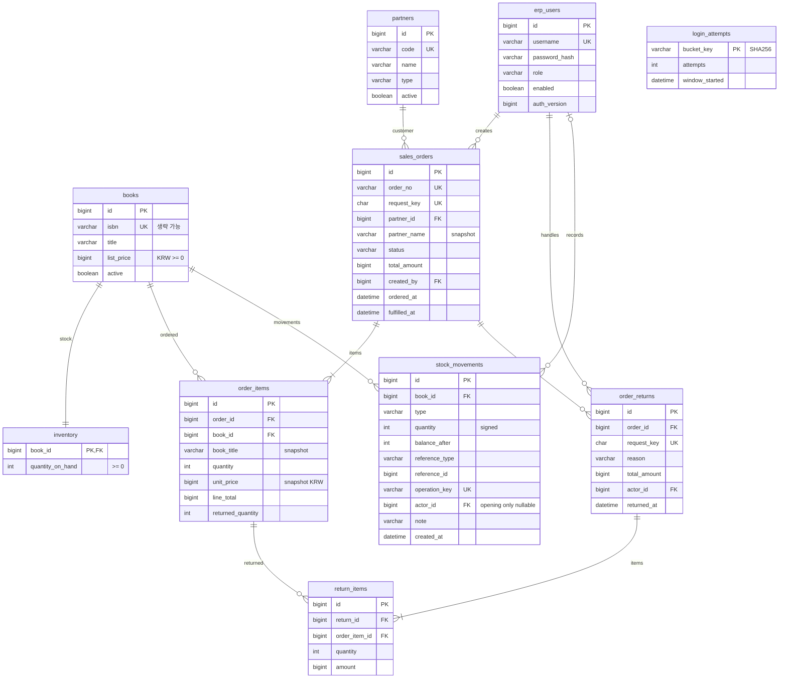

# 데이터 모델 — V1~V3

표의 영문 이름은 실제 SQL 식별자다.

## 제약과 인덱스

- 실제 DDL: resources/db/migration의 V1 기준정보, V2 인증, V3 주문·원장·반품. demo/test 전용 V1.1 합성 도서·거래처 각 3개. DB 문자셋 utf8mb4, collation utf8mb4_unicode_ci.
- ISBN은 생략 시 NULL이며 입력 시 유일하다. 거래처 코드·주문 번호·요청 키·원장 처리 키는 UNIQUE다. 주문/도서는 같은 주문에 한 번만, 반품/품목은 같은 반품에 한 번만 들어간다.
- 주문 상태·날짜, 출고 날짜, 원장 도서/날짜, 반품 날짜와 관계 FK를 인덱싱한다. 부분 검색 LIKE는 현재 소규모 시연용이다.
- 수량·금액·상태 CHECK와 FK로 DB에서도 기본 불변식을 지킨다. 등록 주문은 1~20개 품목, 품목 수량 최대 1,000,000, 단가 최대 999,999,999,999원, 주문 총액 최대 999,999,999,999,999원이다.
- 원장 signed 수량 합계가 현재 잔액과 일치한다. 기존 재고가 있는 DB의 V3 적용 시 해당 잔액을 OPENING 조정 원장으로 이관한다. 원장을 만들기 위해 업무 재고를 0으로 초기화하지 않는다. 이 이관만 actor가 NULL이며 이후 업무 변경은 로그인 직원 번호를 기록한다.
- reference_type/id는 입고·주문·반품 등 서로 다른 테이블을 가리키는 다형 참조여서 FK가 아니다. 실제 주문·품목·반품·도서·직원 관계는 FK로 묶었다. reference_id는 Service가 생성하며 요청값을 직접 신뢰하지 않는다.
- 도서명/거래처명/단가는 주문 시점에 복사한다. 현재 정가나 명칭 변경으로 과거 주문·환불 금액을 바꾸지 않는다. 집계 표의 명칭은 동일 ID의 스냅샷 중 MIN을 표시하며 현재 명칭 기준이 아니다.
- erp_users와 login_attempts에는 원문 비밀번호·세션 ID를 저장하지 않는다. 세션은 단일 JVM 메모리에 있고 로그인 시도 제한의 계정/IP 값은 해시 버킷으로 저장한다.
