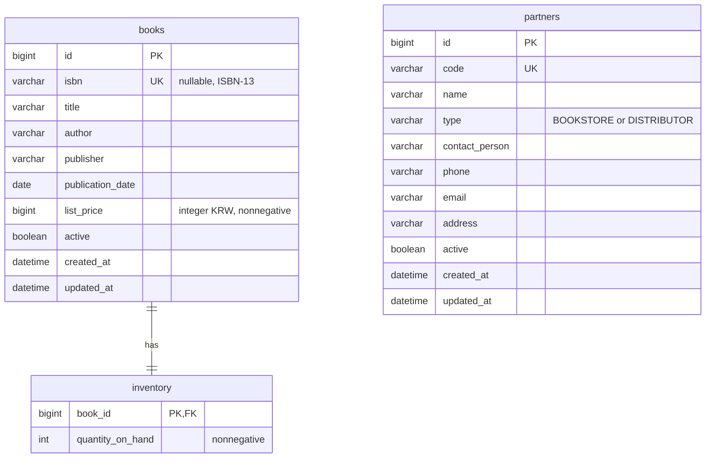

# Phase 1 데이터 모델

`books.id`와 `partners.id`는 자동 증가 기본 키다. ISBN은 생략 시 NULL로 정규화하므로 여러 ISBN 미입력 도서를 허용한다. 코드와 ISBN은 DB 유일 제약으로 중복을 차단한다. 문자셋은 utf8mb4, collation은 utf8mb4_unicode_ci다.

신규 도서 등록 시 서비스가 재고 행을 함께 생성한다. FK는 없는 도서에 대한 재고 행을 거부한다. 비활성화는 데이터와 관계를 보존한다. 사용 상태·등록일 정렬 인덱스와 고유 키 인덱스를 둔다. 부분 문자열 검색은 현재 시연 규모에 맞는 LIKE 조회다.

사용자·주문·주문항목·재고원장·반품 테이블은 아직 만들지 않았다. Phase 2에서는 주문 시점 단가 보존, 출고 시 재고 검사·차감(확정 시 예약하지 않음), 취소·반품 규칙과 동시성 제어를 구현한다.
